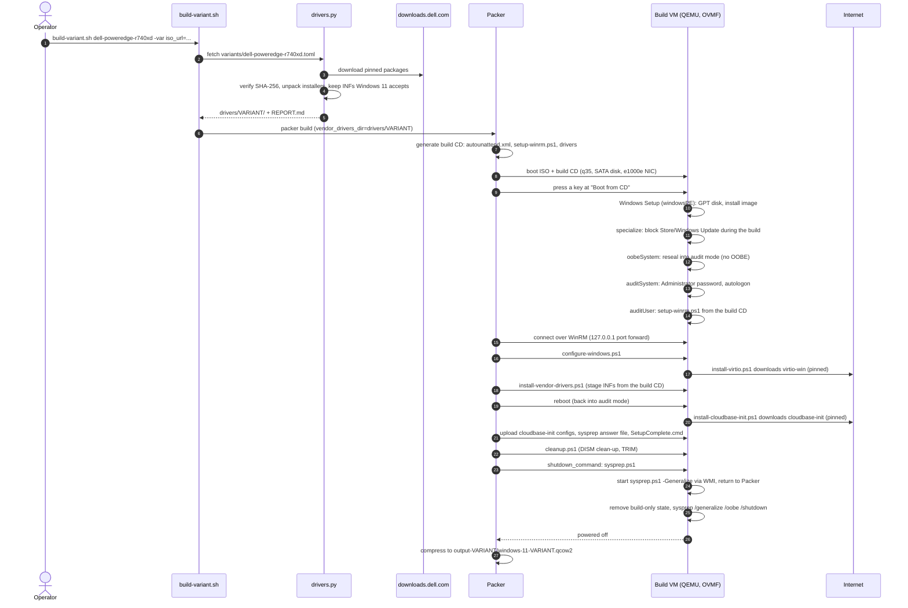
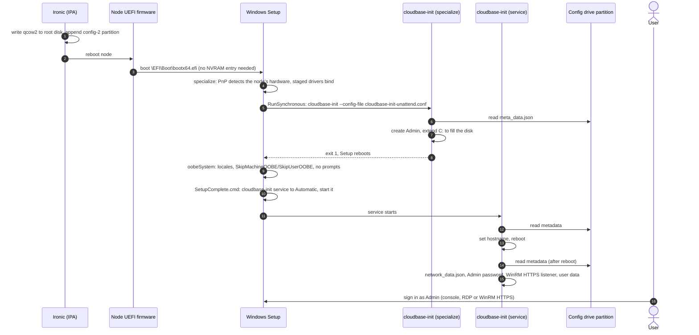

# Design notes: Windows 11 whole-disk images for Ironic

How this repository builds a Windows 11 Enterprise image that OpenStack Ironic
can deploy to bare metal, and why it's built that way. The README covers how
to use it; this document covers how it works.

## Goals

* **Whole-disk qcow2.** Bootloader and partitions included; Ironic writes the
  image as-is to the node's root disk.
* **UEFI only**, GPT layout. Works with Secure Boot on the node.
* **Hardware drivers** for the target models (NIC, storage, chipset), chosen
  per hardware variant and checked against Windows 11 before the build.
* **First boot fully unattended.** Hostname, admin password, network
  configuration and user data come from the Ironic config drive through
  cloudbase-init. No console interaction.
* **Nothing from the build survives into the image** that grants access:
  no build password, no open WinRM, no enabled built-in Administrator.
* **Reproducible.** Every download is pinned by URL and SHA-256, the ISO
  checksum is required, the Packer QEMU plugin is pinned to an exact version
  and the Python dependencies are hash-pinned.

## Components

| Piece | Runs on | Role |
|---|---|---|
| `scripts/build-variant.sh` | Build host | Entry point: fetch a variant's drivers, then run Packer |
| `scripts/drivers.py` | Build host | Download, unpack and check vendor drivers for a variant |
| `variants/*.toml` | Build host | Known hardware models: driver packages and devices |
| `windows-11-ironic.pkr.hcl` | Build host | Packer template: QEMU VM, build CD, provisioners |
| `templates/autounattend.xml.pkrtpl` | Build VM | Answer file for the Windows install itself |
| `scripts/setup-winrm.ps1` | Build VM | Opens WinRM so Packer can connect |
| `scripts/configure-windows.ps1`, `install-*.ps1`, `cleanup.ps1` | Build VM | Provisioners |
| `scripts/sysprep.ps1` | Build VM | Removes build-only state, generalises the image |
| `templates/sysprep-unattend.xml.pkrtpl` | Deployed node | Answer file for the node's first boot |
| `templates/cloudbase-init*.conf.pkrtpl` | Deployed node | cloudbase-init config, specialize stage and service |
| `files/SetupComplete.cmd` | Deployed node | Enables the cloudbase-init service after OOBE |
| `scripts/collect-diagnostics.ps1` | Deployed node | Gathers first-boot logs when something goes wrong |

## Build sequence

## First boot on a deployed node

## Design decisions

### Build VM hardware

The build VM uses a SATA disk (QEMU's `ide` interface, which is AHCI on q35)
and an e1000e NIC. Windows has inbox drivers for both, so nothing has to be
injected into Windows Setup. The e1000e's PXE ROM is removed (`romfile=`) so
OVMF boots straight from the install CD. `-cpu host` is needed because
Windows 11 24H2 and later require SSE4.2/POPCNT, which QEMU's default CPU
model lacks.

The bare-metal hardware is irrelevant to the build: its drivers are only
staged in the driver store, and Windows binds them when it detects the real
devices on the node's first boot.

### Answer file on a CD, not HTTP

Windows Setup can't fetch an answer file over HTTP, but it reads
`autounattend.xml` from the root of any CD. Packer generates a small CD
(label `PACKERCD`) with the answer file, the WinRM setup script and the
variant's drivers, whose directory contents go at the CD root so Setup finds
`$WinPEDriver$` there. Provisioners find it by its label, and the audit-mode
sign-in command by looking for `setup-winrm.ps1` on each drive; never by drive
letter.

### Disk layout

GPT with ESP (260 MB), MSR (16 MB), a 1 GB WinRE partition, then C: using the
rest. C: must be last so cloudbase-init can extend it into the node's larger
disk. Without an explicit recovery partition, Windows Setup shrinks C: and
puts one after it, which would block that.

### Audit mode

Windows is customised in audit mode, never through OOBE. Customising after
OOBE leaves per-user app (AppX) registrations for build-time accounts (the
build's Administrator and OOBE's temporary `defaultuser0`) in the image.
After sysprep those accounts no longer exist, and on a deployed node the
first user to sign in gets almost no system apps registered. The taskbar then
fails to initialise (Explorer aborts in `CTray::Init`) and the screen stays
black after the "Almost there" screen. Audit mode is also how Microsoft intends client
images to be customised.

Audit mode has two side effects the build handles:

* Its passes (`auditSystem`, `auditUser`) run at every audit-mode sign-in, so
  `setup-winrm.ps1` is idempotent.
* Task Scheduler queues tasks while audit mode's OOBE is in progress, and the
  Sysprep window opens at each sign-in. See the next section.

### Running sysprep from a WinRM session

Packer runs `shutdown_command` over WinRM and then closes the shell. Windows
kills every process started from a WinRM shell when the shell closes, so
sysprep can't run there. `sysprep.ps1` starts a second copy of itself through
WMI (`Win32_Process.Create`), whose process is outside the shell, and
returns. A scheduled task would also escape the shell, but Task Scheduler
doesn't run tasks in audit mode.

### Two-stage cloudbase-init

cloudbase-init runs twice on a deployed node:

1. **Specialize pass** (`cloudbase-init-unattend.conf`), from the sysprep
   answer file. It creates `Admin` and extends C:. Creating the account here
   gives OOBE an account so it doesn't ask for one.
2. **Service** (`cloudbase-init.conf`), started by `SetupComplete.cmd` after
   OOBE. It does everything else, including the hostname: Windows 11 OOBE
   would replace a name set during specialize with a random `DESKTOP-xxxx`.

The service stays on Manual until `SetupComplete.cmd`. Otherwise it would run
alongside the specialize-stage run, and it could reboot the machine in the
middle of Setup.

### OOBE on the node

The sysprep answer file presets locales and hides every OOBE page. It also
sets `SkipMachineOOBE` and `SkipUserOOBE`: they're deprecated but still
honoured by Windows 11 25H2, and without them OOBE runs its user stage in a
temporary account and restarts into "Why did my PC restart?".
`PersistAllDeviceInstalls` is false, so Windows re-detects hardware on the
node instead of keeping the build VM's devices.

### Credentials and remote access

* `build_password` has no default; the README generates a random one per
  build. It's used only for Administrator in the build VM.
* Packer's WinRM port forward listens on 127.0.0.1 only.
* Before sysprep, `sysprep.ps1` removes the WinRM HTTP listener, Basic auth,
  unencrypted access and the build's firewall rule, and disables the inbox
  WinRM HTTP rules. It restores UAC remote restrictions, which
  `Enable-PSRemoting` turned off, so a network logon with the local admin
  account doesn't get a full admin token (`remote_local_admin=true` keeps
  them off for nodes managed over WinRM as `Admin`). It also gives the
  built-in Administrator a random password and disables it, and deletes
  Setup's cached copies of the build answer file.
* On the node, cloudbase-init creates `Admin` with the password from the
  config drive's `admin_pass`, and opens WinRM over HTTPS only.

Windows Setup and sysprep free some copies of the build answer file after the
last point the build can run anything, so a raw scan of the image's free disk
blocks finds the build password. It grants nothing: that account is
randomised and disabled.

### Windows 11 behaviours turned off

* **BitLocker device encryption** (`PreventDeviceEncryption`): Windows 11
  can otherwise encrypt a node with a TPM by itself, leaving nobody with the
  recovery key.
* **Smart App Control:** it starts in evaluation mode and can switch itself
  on and block unsigned code such as user-data scripts.
* **Store and Windows Update during the build**: Store app updates make
  Windows 11 sysprep fail. Both policies are removed before sysprep, except
  "consumer features", which stays off on nodes.

### Hardware variants and drivers

Vendor drivers come in self-extracting installers (zip, MSI, WiX Burn,
InstallShield). `drivers.py` unpacks all of these on Linux, then reads each
INF's `[Manufacturer]` decorations the way Windows 11 does. PowerEdge servers
only get Windows Server driver packages; an INF decorated server-only
(`NTamd64.10.0.3`) is silently ignored by Windows 11, so it is dropped and
reported rather than staged. Run separately (it isn't part of
`build-variant.sh`, because it needs the ISO's `install.wim`), `coverage`
checks each device the variant lists has a driver, either inbox or staged.

At build time, `install-vendor-drivers.ps1` cross-checks the build CD against
the variant's `manifest.json` and fails the build if any INF is missing or
can't be staged, so a node can't silently ship without its NIC driver.

Drivers are staged with `pnputil /add-driver`, not installed. That's enough
for NICs and for storage that isn't the boot disk, but not for a boot
controller with no inbox Windows 11 driver: staged drivers are installed when
PnP finds the device, after the boot volume is needed. Packages marked
`boot_critical` (Smart Array S100i software RAID) go in
`$WinPEDriver$` on the build CD instead. Windows Setup injects drivers from
that folder into the image during installation the way `dism /Add-Driver`
does offline: a boot-start service plus the hardware IDs to bind at boot.
The alternatives were worse: `dism /Add-Driver` would need the install image
mounted on the build host (Linux, no DISM), and setting the service to boot
start from a provisioner would also need the PnP database entries Windows
uses to bind a boot device it has never seen.

Every model in a variant's `includes` shares one image. Drivers bind only to
present hardware, so the cost of supporting more models is disk space, and
operators get one Glance image per OS release instead of one per model. The
build CD's Joliet names are limited to 64 characters and paths to 120
(xorriso leaves longer ones off the CD with only a warning), so `fetch`
checks both. The `<variant>/<package>/NN-<dir>` layout fits, but with little
room: the longest path in `dell-hpe-servers` is 113 characters, so long
variant or package names can push it over.

## Scripts and templates

### Build host

**`scripts/build-variant.sh VARIANT [packer options]`**
Entry point for a hardware variant. It:

1. runs `drivers.py fetch variants/VARIANT.toml`, which writes
   `drivers/VARIANT/`;
2. runs `packer init`;
3. runs `packer build` with `vendor_drivers_dir`, `output_directory` and
   `vm_name` set for that variant.

Extra arguments go to `packer build`, and relative paths in them resolve
against the caller's directory (the script doesn't `cd`). It uses `.venv/` for
Python when it exists.

**`scripts/drivers.py`**
Standard library plus 7-Zip and `pymsi`. Subcommands:

* `fetch VARIANT.toml` downloads each package into `.cache/drivers/` and
  checks its SHA-256. It then unpacks recursively:
  * zip/cab/7z through 7-Zip;
  * MSIs through `pymsi`, which keeps real file names;
  * WiX Burn bundles, using their manifest and attached container;
  * InstallShield `ISSetupStream` launchers, decoding their obfuscated
    payload.

  Archive names from the download are kept inside the extraction folder,
  files next to an INF are never unpacked (they belong to that driver), and
  a 7-Zip error fails the fetch rather than caching a partial extraction.
  Extractions are cached per package hash and unpacker version.

  It analyses every INF, copies only accepted driver packages to
  `drivers/VARIANT/` (`drivers/VARIANT/$WinPEDriver$/` for `boot_critical`
  packages), and writes `REPORT.md` and `manifest.json`. Variants in
  `includes` are merged, their packages going under a directory named after
  the included variant; an INF that two included variants both use is staged
  once. Output is deterministic. The fetch fails if a required package has no Windows 11
  driver, if a name or path is over the CD's Joliet limits, or if the
  variant's `name` doesn't match its file name.
* `coverage VARIANT.toml --inbox install.wim` checks each `[[devices]]`
  entry against inbox and staged drivers, and exits non-zero on a gap.
* `check-infs DIR` reports which INFs Windows 11 x64 accepts, for drivers
  added by hand.
* `dell-catalog --system-id ID` suggests the newest Windows driver package
  per family from Dell's catalog, ready to paste into a variant.

**`variants/*.toml`**
One per hardware model:

* `[variant]`: name, description and how the node identifies itself.
* `[[packages]]`: URL, SHA-256, optional `include`/`exclude` patterns
  (Python `fnmatch`: case-sensitive, `*` also matches `/`) and `required`.
* `[[devices]]`: PCI IDs or class codes that `coverage` checks.

`dell-poweredge-r740xd` uses Dell's Server 2022/2025 packages;
`dell-precision-7960-rack` uses Dell's Windows 11 driver pack.

**`windows-11-ironic.pkr.hcl`**
Packer template:

* the QEMU source: q35, OVMF, SATA disk, e1000e NIC, localhost-only WinRM
  forward, build CD;
* the provisioner order;
* the `shutdown_command`.

Variables cover the ISO, image name, locales, sizes, pinned download URLs and
hashes, the cloudbase-init user name and `remote_local_admin`.
`product_key` defaults to the public KMS client key for the edition in
`image_name`, or to none for evaluation media.

### Build VM

**`templates/autounattend.xml.pkrtpl`**
The answer file for installing Windows:

* **windowsPE:** skips the Windows 11 TPM/Secure Boot/RAM/CPU/storage checks
  for the VM, partitions the disk as GPT and selects the image by name.
* **specialize:** blocks Store and Windows Update for the build.
* **oobeSystem:** reseals into audit mode.
* **auditSystem:** sets the Administrator password and autologon.
* **auditUser:** runs `setup-winrm.ps1`.

**`scripts/setup-winrm.ps1`**
Runs from the build CD at each audit-mode sign-in. It:

* switches Public networks to Private;
* enables PowerShell remoting;
* allows Basic auth over HTTP;
* raises shell limits;
* opens TCP 5985.

It's idempotent. `sysprep.ps1` undoes it: listener, Basic auth, unencrypted
access and firewall rules, and UAC remote restrictions unless
`remote_local_admin` is set. The WinRM service itself stays Automatic,
because cloudbase-init's HTTPS listener needs it.

**`scripts/configure-windows.ps1`**

* Enables RDP with Network Level Authentication.
* Blocks BitLocker device encryption.
* Turns off Smart App Control.
* Selects the high-performance power plan, with no sleep or hibernation.
* Creates `C:\Windows\Setup\Scripts` for `SetupComplete.cmd`.

**`scripts/install-virtio.ps1`**
Downloads the pinned virtio-win guest tools (with a non-browser user agent,
since the download site challenges browser-like ones), verifies the SHA-256
and installs them. This lets the image also run on KVM, which is useful for
testing. It can be skipped with `virtio_win_guest_tools_url=""`.

**`scripts/install-vendor-drivers.ps1`**
Finds the build CD by label and stages every INF on it with `pnputil
/add-driver`, without `/install`, so nothing binds to the build VM's emulated
hardware. For a variant build (a `manifest.json` is on the CD) it first checks
the CD holds exactly the INFs the manifest kept, and any staging failure fails
the build. Hand-placed drivers only produce warnings. The driver store is
listed at the end.

**`scripts/install-cloudbase-init.ps1`**
Downloads and verifies the pinned cloudbase-init MSI, installs it quietly
(logging to COM1, running as LocalSystem) and leaves the service on Manual.
It runs after the last build reboot so the service can't run during the
build.

**`scripts/cleanup.ps1`**
Best-effort image shrinking:

* DISM component clean-up with `/ResetBase`;
* temporary files and the Windows Update download cache;
* `Optimize-Volume -ReTrim`, so QEMU discards freed blocks.

It always exits 0.

**`scripts/sysprep.ps1`**
Packer's `shutdown_command`. Without arguments, it starts itself again
through WMI with `-Generalize` and returns. With `-Generalize`, it:

1. removes per-user AppX packages that aren't provisioned (never
   frameworks), which would make sysprep fail;
2. removes the build-only Windows Update and Store policies and the
   autologon;
3. deletes Setup's cached build answer files;
4. removes the build-time WinRM access, and restores UAC remote restrictions
   unless `remote_local_admin` is set;
5. randomises the built-in Administrator's password, and disables the
   account unless cloudbase-init manages it;
6. resets cloudbase-init state;
7. closes the audit-mode Sysprep window;
8. runs `sysprep /generalize /oobe /shutdown` with the sysprep answer file.

### Deployed node

**`templates/sysprep-unattend.xml.pkrtpl`**
The answer file sysprep applies:

* **generalize:** `PersistAllDeviceInstalls=false`.
* **specialize:** time zone; delete the build's `sysprep.ps1`; run
  cloudbase-init with the unattend config.
* **oobeSystem:** locales, all OOBE pages hidden, `SkipMachineOOBE` and
  `SkipUserOOBE`.

**`templates/cloudbase-init-unattend.conf.pkrtpl`**
Specialize-stage config. Metadata comes from the config drive, falling back
to the metadata service. Plugins: MTU, create user, extend volumes. No reboot.

**`templates/cloudbase-init.conf.pkrtpl`**
Service config with the same metadata sources. Plugins:

* MTU, NTP, hostname, user;
* static network config from `network_data.json`;
* licensing, volume extension, password;
* WinRM HTTPS listener and certificate auth;
* user data and local scripts.

Config-drive locations include `partition`, for Ironic's config-drive
partition. `first_logon_behaviour=no`, so RDP with NLA works with the
injected password.

**`files/SetupComplete.cmd`**
Run by Windows once after OOBE. Switches the cloudbase-init service to
Automatic and starts it.

**`scripts/collect-diagnostics.ps1`**
Run by hand on a node that misbehaves. Zips:

* Setup, sysprep and cloudbase-init logs;
* setup state, accounts, disks, network and devices without drivers;
* a metadata-service reachability check;
* the last three days of event logs.

No passwords are collected on purpose, but the cloudbase-init logs include
user-data script output.

## How it was validated

* **Builds:** repeated end-to-end builds of the default image and the R740xd
  variant (about 50 to 57 minutes on a nested-KVM host).
* **Simulated Ironic deploys** of the built image in QEMU, with:
  * fresh UEFI variables;
  * a larger disk;
  * the config drive both on a CD-ROM and as a `config-2` partition appended
    the way Ironic writes it.
* **Pass criteria:**
  * cloudbase-init applies hostname, password, network and user data;
  * C: fills the disk;
  * build-time WinRM and the built-in Administrator are gone;
  * the first console sign-in of `Admin` reaches a working desktop.
* **On the R740xd:** a deploy of an earlier image showed the black-screen
  problem. It was diagnosed with `collect-diagnostics.ps1` and a crash dump,
  then fixed by moving the build to audit mode.
* **Boot-critical drivers:** QEMU can't present an S100i controller, so the
  combined `dell-hpe-servers` image was checked offline instead: its SYSTEM
  hive has the `SmartDQp`/`SmartDQa` services with boot start type, and its
  driver database maps the S100i hardware IDs to the injected INF. No node
  has booted from an S100i yet. PERC S140 was dropped after review: its
  driver also claims Dell NVMe drives by hardware ID.

## Changes from the original plan

The first plan (Packer + QEMU, cloudbase-init, sysprep) still holds, but most
details changed once the build was run:

| Original plan | Now | Why |
|---|---|---|
| Answer file served over HTTP | On a generated CD | Windows Setup can't fetch it over HTTP |
| Extra ISOs via `-drive` in `qemuargs` | No extra ISOs; downloads and build CD | `-drive` in `qemuargs` replaces Packer's own disks and firmware |
| virtio disk and NIC in the build VM | SATA and e1000e | Inbox drivers, nothing to inject into Setup |
| BIOS or UEFI | UEFI only, GPT, WinRE before C: | Requirement; C: must be extendable |
| Customise after OOBE, autologon | Audit mode | OOBE-built images break the first user's taskbar |
| Sysprep as a provisioner and as the shutdown command | Once, from a WMI-started process | WinRM kills shell processes; Task Scheduler is blocked in audit mode |
| cloudbase-init started during the build | Installed last, service Manual until after OOBE | Would record state into the image or reboot mid-Setup |
| cloudbase-init's shipped `Unattend.xml` | Own sysprep answer file | Shipped one stalls Windows 11 OOBE and keeps build-VM devices |
| Vendor drivers copied in by hand | Variants, fetched and checked by `drivers.py` | Repeatable; catches drivers Windows 11 rejects |
| Windows Server 2025 | Windows 11 Enterprise | Target OS |
